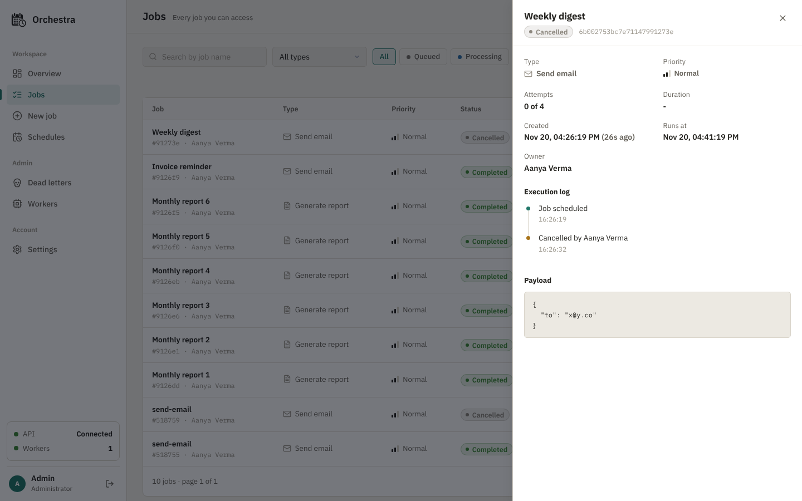
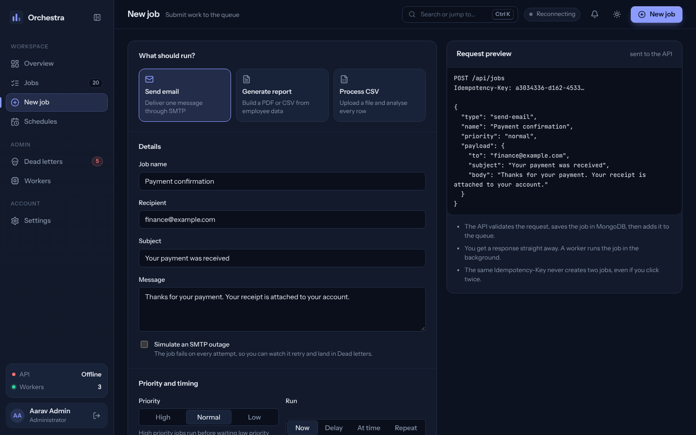
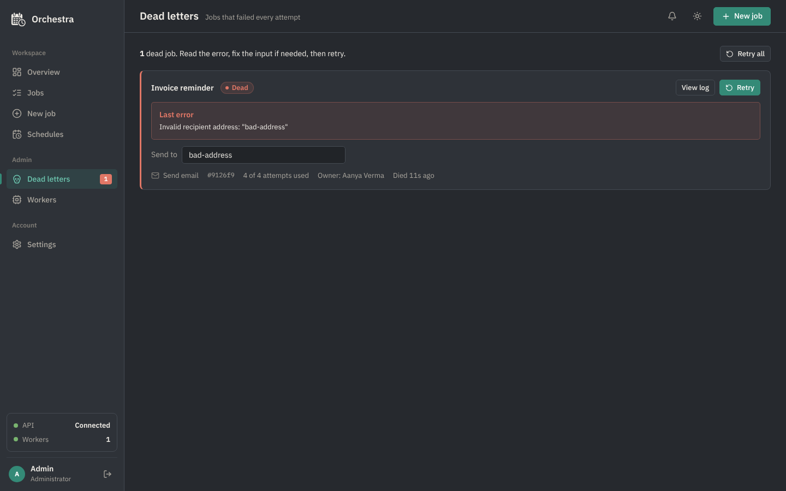
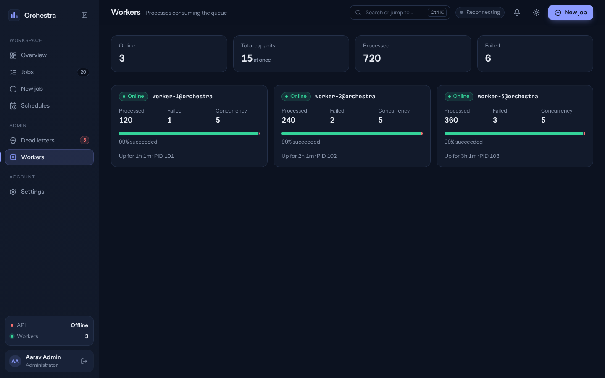
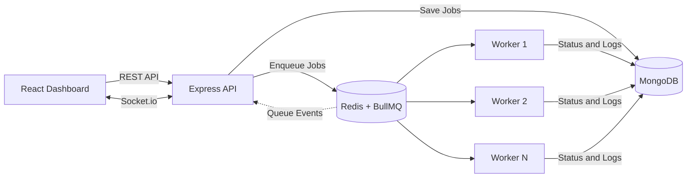

# Orchestra
### Distributed Job Scheduling and Monitoring Platform

Orchestra is a distributed background job processing and monitoring platform built with Node.js, Express, Redis, BullMQ and React. It allows users to submit jobs through a REST API while independent worker processes handle execution, retries and failure recovery.

A real-time dashboard powered by Socket.io provides visibility into job execution, queue activity, worker health and system performance.

The system separates job submission from execution, allowing workers to process tasks independently and scale horizontally as workload increases.


### Dashboard Overview


### Job Management
<table>
  <tr>
    <td width="50%">
      
      <p align="center">Job Details</p>
    </td>
    <td width="50%">
      
      <p align="center">Create Job</p>
    </td>
  </tr>
  <tr>
    <td width="50%">
      
      <p align="center">Dead Letters</p>
    </td>
    <td width="50%">
      
      <p align="center">Worker Monitoring</p>
    </td>
  </tr>
</table>

---

## Tech Stack

| Category | Technologies |
|---|---|
| Frontend | React.js, Vite, CSS, Framer Motion |
| Backend | Node.js, Express.js |
| Database | MongoDB, Mongoose |
| Queue Management | Redis, BullMQ |
| Real-Time Communication | Socket.io |
| Authentication | JWT, bcrypt |
| Background Processing | Node.js Worker Processes |
| AI Integration | Groq API |
| Email Processing | Nodemailer |
| Report Generation | PDFKit, CSV Processing |
| Containerization | Docker, Docker Compose |
| Testing | Jest, Supertest |
| CI/CD | GitHub Actions |

## Core Features

### 1. Background Job Processing
- Submit jobs through REST APIs without waiting for execution.
- Process tasks asynchronously using Redis and BullMQ.
- Support multiple job types, including email delivery, report generation and CSV processing.
- Run independent worker processes to distribute background workloads.
- Support job priorities, delayed execution and recurring jobs using cron expressions.

### 2. Job Lifecycle Management
- Track jobs through queued, processing, completed, retrying, dead and cancelled states.
- Configure automatic retries with exponential backoff.
- Move jobs to a dead-letter state after the configured attempts are exhausted.
- Allow administrators to retry failed jobs.
- Maintain job execution history, attempts and error logs.

### 3. Worker Management and Scaling
- Run multiple worker processes independently of the API server.
- Monitor active workers and their processing activity.
- View worker-level success rates and fleet information.
- Increase processing capacity by scaling worker containers.
- Recover stalled jobs when a worker unexpectedly terminates.

### 4. Real-Time Monitoring
- Live job status updates through Socket.io.
- Dashboard statistics and queue health monitoring.
- Job throughput and status distribution charts.
- Real-time notifications for completed, failed and retried jobs.
- Role-based Socket.io rooms to restrict event visibility.

### 5. Authentication and Access Control
- JWT-based authentication.
- Password hashing with bcrypt.
- Admin and Member roles.
- Role-based authorization for protected operations.
- Public registration cannot create administrator accounts.
- Members can access their own jobs, while administrators can monitor all users' jobs.

### 6. Reliability and Fault Tolerance
- Automatic retry mechanism with exponential backoff.
- Idempotency safeguards to reduce duplicate job creation and processing.
- Redis-based atomic idempotency key management.
- MongoDB unique indexes as an additional protection layer.
- Stalled-job recovery through BullMQ.
- Background sweeper to detect and re-enqueue jobs saved in MongoDB but not successfully added to the queue.
- Rate limiting using Redis counters.

### 7. AI-Powered Failure Explanation
- Provides a simplified explanation of job execution errors.
- Uses a Groq-hosted language model when an API key is configured.
- Falls back to built-in error explanation rules when AI integration is unavailable.
- Sends only relevant error information, job type, attempt counts and recent logs for explanation rather than the complete job payload.

### 8. Dashboard and User Experience
- Responsive landing page with an interactive job lifecycle explanation.
- Dashboard with KPI cards, charts and queue statistics.
- Command palette for quick navigation and job searching.
- Notification center for job activity.
- Bulk job cancellation and CSV export.
- Job table density controls.
- Profile and appearance settings.
- Dark and light themes.
- Keyboard shortcuts for frequently used actions.

---

## Architecture

Orchestra follows a producer-consumer architecture in which the API server handles job submission and independent workers perform the actual processing.



### Component Responsibilities

| Component | Responsibility |
|---|---|
| React Client | User interface, job submission, monitoring and administration |
| Express API | Authentication, validation, authorization, job creation and queue management |
| BullMQ Workers | Background job execution and processing |
| Redis | Queue storage, counters, idempotency and worker-related coordination |
| MongoDB | Persistent storage of users, jobs, attempts, logs and errors |
| Socket.io | Real-time communication between the server and connected clients |

### Job Lifecycle

A typical job follows this execution flow:

```text
Job Submission
      |
      v
    Queued
      |
      v
  Processing
      |
      +-----------> Completed
      |
      v
   Retrying
      |
      v
  Processing
      |
      v
     Dead
```

Jobs can also be scheduled for future execution or cancelled while still queued.

Failed jobs are retried according to the configured attempt count and exponential backoff policy. Jobs that exhaust their attempts are marked as dead and can be retried by an administrator.

---

## Getting Started

### Prerequisites

Make sure the following tools are installed:

- Node.js 22 or later
- npm
- Docker Desktop
- Docker Compose

Docker is the recommended way to run Orchestra because it starts the API, frontend, MongoDB, Redis and worker services together.

### 1. Clone the Repository

```bash
git clone https://github.com/YOUR_USERNAME/Orchestra.git

cd Orchestra
```

Replace `YOUR_USERNAME` with your GitHub username.

### 2. Configure Environment Variables

Copy the example environment file:

```bash
cp .env.example .env
```

The application provides development defaults for local execution.

For production deployments, configure secure values for environment variables such as `JWT_SECRET` and any required API credentials.

### 3. Start Using Docker Compose

Build and start all services:

```bash
docker compose up --build
```

To run everything in detached mode:

```bash
docker compose up --build -d
```

### 4. Open the Application

Visit:

**http://localhost:5173**

You can access the landing page and select the live demo or sign in using the demo accounts.

The dashboard is available at:

**http://localhost:5173/app**

### Demo Accounts

| Role | Email | Password |
|---|---|---|
| Admin | admin@orchestra.dev | Admin@123 |
| Member | demo@orchestra.dev | Demo@1234 |

These accounts are intended for local demonstration only and are created through the application's seed configuration.

Do not use demo credentials or development secrets in a production environment.

---

## Running Without Docker

If you prefer to run each service locally, install and start MongoDB and Redis first.

### Terminal 1: Start the Backend API

```bash
cd server

npm install

cp .env.example .env

npm run dev
```

### Terminal 2: Start the Worker

Open another terminal:

```bash
cd worker

npm install

npm start
```

### Terminal 3: Start the Frontend

Open a third terminal:

```bash
cd client

npm install

npm run dev
```

The frontend development server proxies API and Socket.io requests to the backend running on port 5000.

---

## Testing

Orchestra includes automated tests for the API, queue behavior and worker processors.

### Backend API Tests

```bash
cd server

npm test
```

Covers authentication, role-based access control, idempotency, rate limiting, cancellation, dead-letter retry, failure explanations and statistics caching.

### Queue Integration Tests

Start Redis locally, then run:

```bash
cd server

npm run test:queue
```

Tests queue behavior against a real Redis instance, including:

- Job retry and dead-letter transitions.
- Priority and delayed jobs.
- Duplicate job IDs.
- Cron registration and invalid cron expressions.
- Queue event handling.
- Worker termination and stalled-job recovery.

### Worker Tests

```bash
cd worker

npm test
```

Covers processor behavior, retry decisions, email idempotency safeguards, PDF and CSV generation, and path traversal protection.

The API test suite uses `mongodb-memory-server`, which may download a MongoDB binary on its first execution.

To use an existing MongoDB instance for tests, configure:

```bash
TEST_MONGO_URI=mongodb://localhost:27017
```

---

## Worker Scaling

One of Orchestra's main design principles is separating API servers from background workers.

You can scale workers independently without starting additional frontend or API instances.

For example, start three worker containers:

```bash
docker compose up -d --scale worker=3
```

Open the Admin Dashboard and navigate to **Workers** to monitor the worker fleet.

To inspect worker logs:

```bash
docker compose logs -f worker
```

To scale back to one worker:

```bash
docker compose up -d --scale worker=1
```

---

## Load Testing and Performance Benchmarking

Orchestra includes a load-testing script to evaluate job submission latency, processing throughput and execution time.

### Run the Benchmark

Start the application with an increased rate limit and a shorter simulated processing delay:

```bash
RATE_LIMIT_PER_MIN=100000 SIMULATE_WORK_MS=200 docker compose up -d --build --scale worker=1
```

Run the load test:

```bash
node scripts/loadtest.js --jobs 500 --work-ms 200
```

Repeat with three workers:

```bash
RATE_LIMIT_PER_MIN=100000 SIMULATE_WORK_MS=200 docker compose up -d --scale worker=3
```

```bash
node scripts/loadtest.js --jobs 500 --work-ms 200
```

The script registers a test user, submits jobs through the API and waits for their completion. It reports API response times, total processing time, throughput and a benchmark summary.

Performance results depend on hardware, worker concurrency, database performance and job processing time. Run multiple tests and use measured results when reporting performance figures.

---

## Configuration

Environment variables can be configured using `.env` in the project root.

| Variable | Purpose |
|---|---|
| `JWT_SECRET` | Secret used for signing authentication tokens |
| `RATE_LIMIT_PER_MIN` | Maximum job submissions per user per minute |
| `SEED_ON_START` | Controls demo user creation |
| `SEED_DEMO_DATA` | Controls sample history generation |
| `GROQ_API_KEY` | Optional API key for AI-powered failure explanations |
| `GROQ_MODEL` | Model used for failure explanations |
| `WORKER_CONCURRENCY` | Number of jobs processed concurrently by each worker |
| `MAIL_MODE` | Email processing mode, including JSON and Ethereal |
| `SIMULATE_WORK_MS` | Simulated processing delay for demonstration and testing |

Refer to `.env.example` for the actual default values and additional environment configuration.

---

## Useful Docker Commands

| Command | Description |
|---|---|
| `docker compose up --build` | Build and start services |
| `docker compose up -d` | Start services in the background |
| `docker compose ps` | List running containers |
| `docker compose logs -f` | Follow application logs |
| `docker compose logs -f worker` | View worker logs |
| `docker compose restart` | Restart services |
| `docker compose down` | Stop and remove containers |
| `docker compose down -v` | Stop services and remove persistent volumes |

**Note:** Removing volumes deletes persistent MongoDB and Redis data.

---

## Design Decisions and Limitations

Some architectural decisions and trade-offs in Orchestra include:

- **Database-first job creation:** Jobs are saved to MongoDB before being added to BullMQ. A background sweeper attempts to recover jobs that were saved but not successfully enqueued.
- **At-least-once processing:** Jobs may be executed again after failures or worker crashes. Idempotency safeguards help reduce duplicate side effects.
- **Application-managed dead letters:** Orchestra maintains its own dead-job state and management interface instead of relying on a separate BullMQ dead-letter queue.
- **Redis availability:** The current setup uses a single Redis instance, making Redis a potential single point of failure.
- **Multiple API instances:** A Redis adapter for Socket.io would be needed to distribute real-time events across multiple API instances.
- **Event synchronization:** MongoDB job states and queue events may briefly differ. The dashboard refetches data to reconcile its displayed state.
- **Stalled-job recovery:** Recovery time depends on BullMQ lock duration and stalled-job detection settings.
- **MongoDB compatibility:** Dashboard statistics use `$dateTrunc`, which requires MongoDB 5.0 or later.

These are important considerations for scaling the application toward a production deployment.

---

## Project Structure

```text
Orchestra/
│
├── .github/
│   └── workflows/
│       └── ci.yml
│
├── client/
│   ├── src/
│   ├── public/
│   ├── package.json
│   └── Dockerfile
│
├── server/
│   ├── controllers/
│   ├── routes/
│   ├── middleware/
│   ├── models/
│   ├── services/
│   ├── tests/
│   └── package.json
│
├── worker/
│   ├── processors/
│   ├── tests/
│   ├── package.json
│   └── Dockerfile
│
├── scripts/
│   └── loadtest.js
│
├── docs/
│   └── screenshots/
│
├── .env.example
├── .gitignore
├── docker-compose.yml
└── README.md
```

*The structure above illustrates the main project components. Individual folders may contain additional files and modules.*

---

## CI/CD

The project uses GitHub Actions to automate testing and build verification.

The CI workflow runs separate jobs for:

- Backend API tests with MongoDB and Redis services.
- Queue integration tests.
- Worker processor tests.
- Frontend production build verification.
- Load-test script syntax validation.

Workflow configuration:

```text
.github/workflows/ci.yml
```

This helps catch integration issues and build failures whenever changes are pushed or pull requests are opened.

---

## Demo Walkthrough

The following sequence demonstrates the main capabilities of Orchestra.

1. **Dashboard Overview:** Explore job statistics, queue health, throughput and worker activity.
2. **Submit a Job:** Create a report-generation job and observe its lifecycle in real time.
3. **Failure Handling:** Simulate an SMTP failure, observe retries and inspect the dead-letter entry.
4. **Failure Explanation:** Use the failure explanation feature to understand the error.
5. **Worker Scaling:** Start additional workers and submit multiple jobs to observe distributed processing.
6. **Crash Recovery:** Terminate a worker unexpectedly and observe BullMQ's stalled-job recovery.
7. **Idempotency:** Submit requests with the same idempotency key and verify that duplicate job creation is prevented.

---

## Future Improvements

Potential improvements for future versions include:

- Distributed Socket.io scaling using Redis adapters.
- More advanced queue analytics and observability.
- Enhanced worker health checks and alerting.
- Production-grade Redis high availability.
- More configurable retry and scheduling policies.
- Improved deployment automation and monitoring.

---

**Orchestra** — Reliable background processing, independent workers and real-time job visibility.

Author- Aanya Verma
Linkdin- https://www.linkedin.com/in/aanya-verma-74a1872a3/
