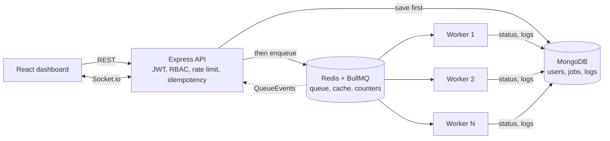

# Orchestra

**A distributed job scheduling and monitoring platform.**
An Express API accepts jobs and puts them on a Redis-backed BullMQ queue. Separate worker processes run them. A React dashboard shows every job moving through the pipeline in real time over Socket.io.

> Submitting a job returns in milliseconds. The slow work (emails, PDF reports, CSV processing) happens in the background, on workers you can scale independently.


<table>
  <tr>
    <td width="50%">
</td>
    <td width="50%">
</td>
  </tr>
  <tr>
    <td width="50%">
</td>
    <td width="50%">
</td>
  </tr>
</table>

## Quick start

Requires Docker.

```bash
docker compose up --build
```

Open **[https://orchestra-aanya.duckdns.org/]** for the home page, then choose **Try the live demo** or use **Admin demo** / **Member demo** on the sign-in page. The dashboard lives at `/app`.

| Account | Email | Password |
| --- | --- | --- |
| Admin | admin@orchestra.dev | Admin@123 |
| Member | demo@orchestra.dev | Demo@1234 |

These are created on first start (`SEED_ON_START`). Change `JWT_SECRET` and turn seeding off for anything real.

## Testing with several users and several workers

- **Users and workers are different things.** A worker is a background process that runs jobs. Signing in never creates one. The default setup runs one worker, so "1 worker" is correct.
- **More workers:** `docker compose up -d --scale worker=3`, then open Admin > Workers. Three cards appear.
- **Several people at once:** each browser tab keeps its own login by default. Open one normal tab as Admin, a second tab (or another browser) as one member, a third as another member. All incognito windows share one session, so use a different browser profile or tab instead. Admin > Workers > *People signed in* lists everyone online.
- **Starting clean:** sample jobs are off by default. To wipe all local data, run `docker compose down -v`. This deletes every user and job, so never run it on a live server.
- Admin sees every user's jobs in the totals, members see only their own.

## Architecture



| Part | Responsibility | Must not |
| --- | --- | --- |
| Client | Login, create jobs, live job table, charts, admin pages | Hold business rules |
| API (`server/`) | Validate, authenticate, rate-limit, save the job, enqueue it, serve lists and stats, forward live events | Run the slow work |
| Worker (`worker/`) | Pull jobs, run processors, write status and logs | Talk to browsers |
| MongoDB | Permanent record: users, jobs, attempts, errors | Act as the queue |
| Redis + BullMQ | Live queue, rate-limit counters, idempotency keys, cached stats, worker heartbeats | Be the only copy of history |

### Job lifecycle

`scheduled` or `queued` → `processing` → `completed`
On error: `processing` → `retrying` (exponential backoff 2s, 4s, 8s) → `dead` after 4 attempts. An admin can retry a dead job; the retry switches off the *Simulate outage* flag and lets the admin correct a bad email address, so it does not just fail again. A queued, scheduled or retrying job can also be `cancelled`. If a worker dies mid-job, the job goes back to `queued` and another worker finishes it.

## What is implemented

**Interface**
- **Landing page** (`/`) with a queue-monitor preview, how it works, features, an interactive job-lifecycle explainer, architecture, FAQ and call to action.
- **Dashboard** (`/app`): summary cards, live pipeline, throughput chart, jobs by status, recent jobs and a live activity feed. Sidebar badges for running and dead jobs, page transitions.
- **Notification bell** that collects completed, failed and retried jobs in real time.
- **Jobs page**: filters, search, CSV export of the current filter, compact or comfortable density. Open a job to see its log; queued, scheduled and retrying jobs can be cancelled from there.
- **Dead letters**: fix the recipient and retry one job, or Retry all. **Workers**: fleet summary and per-worker success rate.
- **Settings page** for profile, theme and table density.

- **Auth**: JWT, bcrypt, Admin and Member roles. Public sign-up can never create an admin.
- **Three real job types**: send email (Nodemailer), generate report (PDF or CSV via PDFKit, downloadable), process CSV (streamed upload analysis).
- **Reliability**: retries with exponential backoff, dead-letter page with a Retry button, stalled-job recovery when a worker dies, idempotent processors (an email is never sent twice).
- **Idempotency keys**: the same `Idempotency-Key` header creates one job, even when several identical requests arrive at the same moment. Redis claims the key atomically (`SET NX`, 24 hours), and a unique MongoDB index is a second safety net.
- **Rate limiting**: Redis counter per user per minute, then `429`.
- **Priority, delayed and recurring (cron) jobs**. The Create job form has Now, Delay, At time and Repeat.
- **Cache-aside stats**: dashboard numbers cached in Redis for 30 seconds, invalidated when jobs change state.
- **Live dashboard**: Socket.io rooms, so a member only receives their own jobs and admins receive all.
- **Failure explainer**: "Explain this failure" turns an error into two plain sentences. It uses a Groq model when `GROQ_API_KEY` is set and built-in rules otherwise. Only the job type, error text, attempt counts and recent log lines are ever sent, never the job payload.
- **Outbox-style sweeper**: if the API saves a job but dies before queueing it, a background sweeper re-enqueues it.
- **Tests and CI**: Jest and Supertest for the API, queue tests against a real Redis (including killing a worker mid-job), worker processor tests, and a GitHub Actions workflow with real MongoDB and Redis services.

## Five-minute demo script

1. **Overview.** Show the pipeline band and throughput chart. Say the one-line pitch.
2. **Live status.** New job → Generate report (5,000 employees). Watch it go queued → processing → completed on the Jobs page, then download the PDF from the drawer.
3. **Failure path.** New job → Send email → tick *Simulate an SMTP outage*. Watch it retry, then land in **Dead letters**. Open it, click **Explain this failure**, read the log, click **Retry job**. This time it completes, because retrying turns the simulated outage off.
4. **Scaling.** In another terminal: `docker compose up -d --scale worker=3`. Submit 20 jobs. Open **Workers** (admin) and run `docker compose logs -f worker` to see different workers pick different jobs.
5. **Crash recovery.** Start a long job (a report with 50,000 employees). Find a worker with `docker compose ps`, then `docker kill <that worker container>`. Another worker finishes the job after BullMQ's lock expires, about a minute with the default settings. The job log shows "The worker running this job stopped responding". Use `docker kill`, not `docker stop`: stop sends SIGTERM and the worker drains gracefully by design.
6. **Idempotency.** Submit the form twice quickly. One job is created.

## Load test

Use this script to measure throughput on your own machine.

```bash
# 1. Start with a high rate limit and a short simulated delay, one worker
RATE_LIMIT_PER_MIN=100000 SIMULATE_WORK_MS=200 docker compose up -d --build --scale worker=1
node scripts/loadtest.js --jobs 500 --work-ms 200

# 2. Repeat with three workers and compare
RATE_LIMIT_PER_MIN=100000 SIMULATE_WORK_MS=200 docker compose up -d --scale worker=3
node scripts/loadtest.js --jobs 500 --work-ms 200
```

It registers its own user, submits the jobs through the real API, waits until all finish, and prints the API response times, total time and throughput. Notes for reading the results:

- The result depends on your machine, on `SIMULATE_WORK_MS` (the pause inside every job) and on MongoDB speed. State the settings next to any number you share.
- Run it a few times and report a typical run. If three workers are not faster than one, look at CPU and MongoDB first, because every job makes several database writes.
- Reaching `429` means the rate limit was not raised. Restart with `RATE_LIMIT_PER_MIN=100000`.

## Running without Docker

Needs Node 22, MongoDB and Redis running locally.

> The API uses port **5050**, not 5000: on macOS, port 5000 belongs to AirPlay Receiver, which answers instead of the API and makes sign-in fail. If your old `server/.env` still says `PORT=5000`, change it to `PORT=5050`.

```bash
# terminal 1: API on port 5050 (copy server/.env.example to server/.env first)
cd server && npm install && npm run dev
# terminal 2: worker
cd worker && npm install && npm start
# terminal 3: dashboard (proxies /api and /socket.io to localhost:5050)
cd client && npm install && npm run dev
```

## Tests

```bash
cd server && npm test          # API tests: auth, RBAC, idempotency (including a race), rate limit, cancel, dead-letter retry, explain, stats cache
cd server && npm run test:queue   # queue behaviour against a real Redis on localhost:6379
cd worker && npm test          # processors: retry decision, email idempotency, PDF/CSV output, path traversal
```

- The queue tests cover retry → dead after 4 attempts, priority order, delayed jobs, duplicate job ids, removing and re-queueing a failed job, QueueEvents ids, cron registration, rejection of an invalid cron expression, and **killing a worker with SIGKILL while it holds a job and watching another worker finish it**.
- The API tests use `mongodb-memory-server` (downloads a MongoDB binary on first run). To use a MongoDB you already run instead, set `TEST_MONGO_URI=mongodb://localhost:27017`.

## Configuration

Copy `.env.example` to `.env` next to `docker-compose.yml` to change these. Every value has a working default.

| Variable | Default | Where | Purpose |
| --- | --- | --- | --- |
| `JWT_SECRET` | dev value | server | Signing key. Set a long random value. |
| `RATE_LIMIT_PER_MIN` | 20 | server | Job submissions per user per minute |
| `SEED_ON_START` / `SEED_DEMO_DATA` | true in Compose | server | Create demo users and sample history |
| `GROQ_API_KEY` / `GROQ_MODEL` | empty | server | Optional AI failure summaries. Built-in rules are used without a key. |
| `WORKER_CONCURRENCY` | 5 | worker | Jobs run at once per worker |
| `MAIL_MODE` | `json` | worker | `ethereal` sends to a fake inbox and returns a preview link (needs internet) |
| `SIMULATE_WORK_MS` | 1500 | worker | Pause inside processors so status changes are visible. Use 0 to 200 for load tests. |

## Design decisions and honest limitations

- **Save to MongoDB first, then enqueue.** Nothing is lost if the queue call fails. The sweeper repairs the gap. A full outbox pattern would be the next step.
- **At-least-once delivery.** Retries or crash recovery can run a job twice, so processors check saved progress before repeating side effects.
- **No built-in dead-letter queue in BullMQ.** Orchestra marks a job `dead` once attempts are used up and lists those on its own page.
- **Single Redis instance** is a single point of failure. Compose enables AOF persistence. Production would use a managed or replicated Redis.
- **Multiple API servers** would need the Socket.io Redis adapter so events reach every connected client.
- **Status in MongoDB and queue events can briefly disagree.** The dashboard shows the last event received and refetches to settle.
- **Crash recovery takes about a minute** with BullMQ defaults (30 s lock, 30 s stalled check). Shorter values recover faster but risk false stalls when a job blocks the event loop.
- **Stats use `$dateTrunc`**, which needs MongoDB 5.0 or newer (Compose uses 7). Some MongoDB-compatible services do not support it.

## Structure

```
orchestra/
  docker-compose.yml
  .env.example
  scripts/loadtest.js     load test
  docs/screenshots/       images used above
  client/   React + Vite app (Source Sans 3, white-and-orange light theme, dark theme in the dashboard)
  server/   Express API: routes, controllers, middleware, queue producer, sockets, sweeper, explain service, tests
  worker/   BullMQ worker and processors (email, report, csv), tests
  .github/  CI workflow
```

## Recent additions

- **White-and-orange light theme** across the landing page, sign-in page and dashboard. Dark mode is still available inside the dashboard (`/app`) from the top bar or Settings; the home, sign-in and help pages are always light.
- **Calendar-and-clock logo**, used as the app logo and browser icon.
- **Help and legal pages** linked from the footer: Privacy, Terms of use, Legal disclosure, Copyright, Trademark, Disclaimer, API Policy, Contact and a Help portal.
- **Cookie Preferences** in the footer. Shows what the app keeps in the browser (a sign-in token, theme and table density; no cookies or trackers) and can clear the saved settings.
- **Sign-in health check.** The sign-in page checks the API when it loads and says exactly what is wrong (API not running, MongoDB or Redis down) instead of a generic "Could not sign you in" message.
- **API moved to port 5050**, because macOS uses port 5000 for AirPlay Receiver.
- **Dead-letter retry that actually succeeds.** Retrying switches off the *Simulate outage* flag, and an admin can correct a bad email address before retrying. CSV jobs whose file is missing are refused with a clear message instead of failing again.
- **Cancel from the job panel.** Queued, scheduled and retrying jobs show a Cancel button; running jobs explain why they can no longer be cancelled.

## Deploying (HTTPS with Caddy)

On the server, keep host-specific settings in `docker-compose.override.yml`. Docker Compose loads it automatically, and git does not track it, so `git pull` never conflicts. It adds a Caddy container that serves the site over HTTPS and sets `CLIENT_ORIGIN` to your domain:

```yaml
services:
  server:
    environment:
      CLIENT_ORIGIN: https://your-domain.example
  caddy:
    image: caddy:2
    restart: unless-stopped
    ports:
      - "80:80"
      - "443:443"
    volumes:
      - ./Caddyfile:/etc/caddy/Caddyfile:ro
      - caddy-data:/data
      - caddy-config:/config
    depends_on:
      - client
volumes:
  caddy-data:
  caddy-config:
```

`Caddyfile`:

```
your-domain.example {
    encode gzip
    reverse_proxy client:80
}
```

Only ports 22, 80 and 443 need to be open in the firewall or security group. To update a running server:

```bash
git pull
sudo docker compose up -d --build
```
